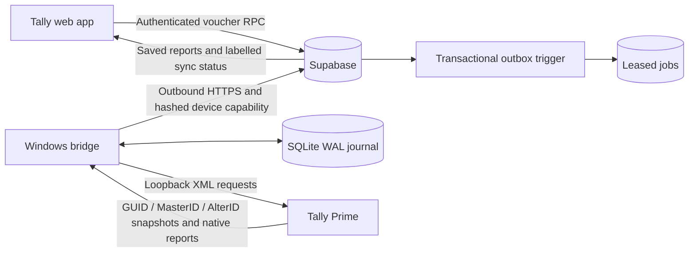

# Sync contract

## Voucher state machine

1. An authenticated voucher save and its outbox job commit in the same PostgreSQL transaction. Only business-field changes create a new revision. Marking an export, changing sync state, or applying incoming Tally data does not enqueue another write. Older unstarted revisions are superseded.
2. One active device is paired to one company GUID. Each worker has an instance lease; the Windows worker and supervisor also hold named mutexes. Jobs are claimed with row locks, a random lease token and an expiry. The device credential alone does not grant direct table access.
3. Before posting, the worker verifies company identity, looks up the target GUID or type+number with one filtered read, checks current AlterID and validates the party, sales ledger, R/off, stock item and voucher type live in Tally (masters are not mirrored). An already matching invoice is linked without importing it again. A different invoice with the same number is a conflict.
4. `tally_bridge_begin_write` locks the voucher before its job, validates the current revision/lease and records `writing` with `write_started=true`. While writing, web edits and deletion are blocked. A superseded claim cannot start a write.
5. The worker durably records `writing`, sends one Create/Alter, and performs a fresh read-back. Confirmation requires matching accounting fields, a GUID and AlterID. A failed/lost acknowledgement is idempotently recoverable.
6. Expired `writing` jobs are **reconciliation-only**, even if their original request might never have reached Tally. This trades unattended progress for avoiding duplicate financial entries. Rechecks never reset `write_started`. Only a pre-write failure can be retried as a posting job.

Tally Prime does not participate in the PostgreSQL transaction. There remains a narrow race with a user editing the same voucher directly in Tally between the version read and Alter. No claim of atomic cross-system writes is made.

## Inbound data

Only HSD/MS/XG CREDIT vouchers are read: a `$VoucherTypeName` filter, plus `$AlterID > cursor` on idle polls. Metadata is read with native GUID, MasterID and AlterID methods, one `NATIVEMETHOD` tag each. Detailed objects are fetched in batches of 30 MasterIDs. The cursor advances to the **metadata snapshot's** highest AlterID, not a subsequently fetched object's newer AlterID: otherwise an intervening change to another voucher could be skipped.

Objects and pending cloud uploads commit together in SQLite. A lost cloud acknowledgement resends the same version. Supabase upserts by kind/GUID, rejects decreasing versions, and does not overwrite pending web edits. Only a complete, validated collection scan may mark missing identities deleted. Tombstones preserve the prior data. Full snapshots are scoped to the verified company and dates 1900–2099. Transport responses and upload batches are bounded; oversized exports fail visibly instead of advancing a checkpoint.

Incoming fuel vouchers only update vouchers the app already has: a linked voucher by GUID, or on first sighting an `unlinked` app voucher with the same type and number. Tally is the source of truth for those. A fuel voucher the app lacks is stored privately (for linking a later Import from Tally) and reserves its number, but is not added to history; Import from Tally remains the way in. A queued or in-flight web voucher is reconciled by its own job, never overwritten by ingest.

Import from Tally sets `vriddhi.tally_import` for its transaction. The voucher trigger then queues nothing and skips rows that are bridge-linked or in flight, which the import reports as *kept*. Afterwards `_tb_link_imported()` links new rows to vouchers the bridge has already read. All table and function changes are in `supabase/tally-bridge.sql`.

## Reports and browser boundaries

The report key includes report type, exact period and ledger. Duplicate requests share an active job. Refreshes retain the previous result; an error never overwrites it with an empty report. Report HTML is stored separately from job audit metadata. Read-only report polling cannot create a retry storm. Worker and browser each allowlist HTML before an opaque sandboxed iframe displays it. The browser's authenticated session is checked on every RPC and outstanding results are discarded if the session changes.

## Operational limits

Version 1.0.1 validates complete identity snapshots on restart and during outgoing lookups; details must be at least as recent as their advertised metadata. A lower highest revision, including deletion of the highest-version object, fails closed for review. The server blocks web edits while a selected Tally version is still being fetched. Browser PDF/XLSX exports are bound to one selected report snapshot and authentication epoch; source times and offline/refresh status travel with the file. Excel preserves the displayed source alongside explicitly numeric amount columns and never emits formulas from report text.

- No inbound firewall rule, arbitrary SQL, remote shell, payment action or Tally deletion capability exists in the device protocol.
- SQL uses the app's existing equal-employee authorization model; pairing is not owner-only.
- Worker polls with backoff/jitter; periodic deletes can take an hour to appear. Native reports refresh only when requested.
- Ordinary job/audit history is retained. Large companies may need explicit archival/storage policy and larger bounded export pagination.
- Journal/config backups and Tally company backups remain essential. Reinstalling must preserve the journal. A new company GUID requires a deliberate financial-year migration.
- Test fixtures validate protocol shape, invariants and recovery. Real Tally Prime acceptance and company-specific report compatibility require the Windows PC.

## Background recovery and package trust

The signed-in Windows account owns a least-privilege interactive scheduled task, sign-in fallback and cross-session per-user mutexes. The task can recover a stopped supervisor; the supervisor can restart a failed worker. An explicit Stop marker persists and is honoured by both. The same user's DPAPI protection and journal binding remain unchanged; no Windows or Tally password is stored. The optional system-awake request ends with the worker and does not prevent display locking or rewrite global power settings.

Before claiming jobs, the worker verifies Tally. If HTTP is unavailable and no Tally process exists in the current interactive session, it may start the configured local installation minimized using the numeric company argument. A running process is never killed or duplicated. Startup attempts have persistent bounded backoff. The exact name/GUID check and a full identity reconciliation gate resumed work, including all existing restore and uncertain-write safeguards. A prompt, hung process, missing installation or wrong company remains visible for review rather than being clicked through automatically.

Distribution uses an unmodified CPython runtime and readable source in a ZIP, with per-file integrity checks before installation. Core CPython publisher signatures and the actual CI Defender scan status are published separately. Scripts/ZIP are not Authenticode signed, and checksum/signature checks are not a malware-clearance claim. Installation registers visible startup entries; uninstall unregisters them without encoded/delayed cleanup scripts. No antivirus settings or exclusions are changed. Old 1.0.1 local mutexes are checked during graceful upgrades before any replacement worker starts.
